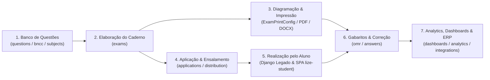

# Índice e Grafo Operacional de Telas Mapeadas (`.ai_qa_acervo`)

> **Propósito:** Mapa central de navegação e dependências cruzadas extraído de `docs/*.md` e `fiscallizeon/*/tasks/` do repositório `lizeedu`, conectando os **49 arquivos de mapeamento de tela** deste diretório.
> **Regra de Uso pela IA (`Surgical Relevance Filter`):** Use este grafo como **radar investigativo** durante a criação de planos de QA (`/qa-create-plan`). Só inclua no plano de testes os consumidores (telas downstream ou tasks de importação/exportação) que **realmente consumirem o campo, partial, endpoint ou regra de negócio alterada no `git diff` atual**.

---

## Visão Macro do Ciclo de Vida do Dado no Lize Edu

---

## 1. Domínio: Banco de Questões & Elaboração de Caderno (`questions` ➔ `exams`)
> **Docs Canônicos no Repo:** `docs/questions.md`, `docs/exams.md`, `docs/subjects.md`

| Papel no Fluxo | Arquivos Mapeados no Acervo (`docs/tests/usability/`) | Tasks em Lote / Portas Irmãs (`fiscallizeon/`) | Campos Críticos com Impacto Cruzado |
|---|---|---|---|
| **Cadastro e Configuração de Questões** | [question_create_update_redesign.md](./question_create_update_redesign.md), [question_create_update.md](./question_create_update.md), [questions_configutation.md](./questions_configutation.md), [subject_code_list_create.md](./subject_code_list_create.md) | `exams/tasks/create_exam_question_with_ia.py`, importação DOCX em `exam_request_teacher_subject_edit_new` | `Question.category` (Objetiva/Discursiva/Arquivo), `Question.base_texts` (M2M), `Question.number_is_hidden`, `Question.print_only_enunciation` |
| **Criação e Listagem de Caderno (Coordenação)** | [exam_request_create_update_new.md](./exam_request_create_update_new.md), [exam_list_new.md](./exam_list_new.md) | `exams/tasks/exams_imports.py` (CSV Cadernos), `exams/tasks/exam_deadline_import_task.py` (CSV Prazos), `omr/tasks/template_imports.py` (CSV Gabarito Avulso), `exams/tasks/copy_exam_with_ia.py` | `Exam.base_text_location`, `Exam.category` (Prova vs Lista), `Exam.exam_format` (Padrão vs PAS), `Exam.group_discursive_questions`, `Exam.is_english_spanish`, `Exam.status` |
| **Elaboração e Inserção de Itens (Professor / Coordenação)** | [exam_detail_v2.md](./exam_detail_v2.md), [exam_detail_new.md](./exam_detail_new.md), [exam_detail_enunciation_new.md](./exam_detail_enunciation_new.md), [exam_request_teacher_subject_edit_new.md](./exam_request_teacher_subject_edit_new.md), [exam_teacher_create_update.md](./exam_teacher_create_update.md) *(legado v1 descontinuado; ativo = `v2`)* | Duplicação de caderno (`source_exam`), geração automática via `system.DidacticMaterial` | `ExamTeacherSubject.order`, `ExamTeacherSubject.subject_note`, `ExamQuestion.order`, `ExamQuestion.weight`, `StatusQuestion` (Aprovada/Anulada/Reprovada) |
| **Revisão Pedagógica e Ortográfica** | [teacher_exam_to_review_list.md](./teacher_exam_to_review_list.md), [modal_review.md](./modal_review.md), [reviewer_production_report.md](./reviewer_production_report.md) | `dashboards/tasks/export_reviewer_production.py` | `Exam.status` (gatilho `notify_reviewers_on_status_change`), `Question.review_status` |

---

## 2. Domínio: Diagramação, Impressão & Layout (`clients.ExamPrintConfig` ➔ `exams` / `omr`)
> **Docs Canônicos no Repo:** `docs/diagramations.md`, `docs/exams.md`, `docs/omr.md`

| Papel no Fluxo | Arquivos Mapeados no Acervo (`docs/tests/usability/`) | Tasks em Lote / Portas Irmãs (`fiscallizeon/`) | Campos Críticos com Impacto Cruzado |
|---|---|---|---|
| **Padrões e Modal de Impressão (Entrada)** | [print_defaults_create_update.md](./print_defaults_create_update.md), [exam_configs_form.md](./exam_configs_form.md), [diagram_layout_structure.md](./diagram_layout_structure.md), [diagram_layout_font.md](./diagram_layout_font.md), [diagram_layout_alternatives.md](./diagram_layout_alternatives.md), [modal_print.md](./modal_print.md), [omr_print_separation_update_or_create.md](./omr_print_separation_update_or_create.md) | Endpoint `exams:api-exam-generate-print-preview`, `exams:exam_Export_custom_pages` | `ExamPrintConfig.separate_subjects` (`0`=Único, `1`=Disciplina, `2`=Tipo Obj/Disc), `hide_numbering`, `hide_questions_referencies`, `discursive_line_height`, `column_type`, `economy_mode` |
| **Renderização HTML/PDF e Preview (Saída)** | [exam_print.md](./exam_print.md), [exam_homework_print.md](./exam_homework_print.md), [exam_preview.md](./exam_preview.md), [exam_preview_redesign.md](./exam_preview_redesign.md) | `exams/tasks/print_docx_task.py`, `distribution/tasks/export_exams_bag.py`, `applications/tasks/export_application_exams.py`, `omr/tasks/export_answer_sheet.py` | Partials compartilhados (`includes/base_texts/*.html`, `base_texts-functions.js`, `print_functions.js`). **Atenção:** `printConfig` existe no Vue de `exam_print.html`, mas é `undefined` nos demais templates pais! |

---

## 3. Domínio: Aplicação, Ensalamento & Realização pelo Aluno (`applications` ➔ `distribution` ➔ `student`)
> **Docs Canônicos no Repo:** `docs/applications.md`, `docs/distribution.md`, `docs/app.md`

| Papel no Fluxo | Arquivos Mapeados no Acervo (`docs/tests/usability/`) | Tasks em Lote / Portas Irmãs (`fiscallizeon/`) | Campos Críticos com Impacto Cruzado |
|---|---|---|---|
| **Agendamento e Gestão de Aplicações** | [application_create_update.md](./application_create_update.md), [application_list_new.md](./application_list_new.md), [application_instrument_list.md](./application_instrument_list.md), [complete_application_instrument.md](./complete_application_instrument.md), [calendar_index.md](./calendar_index.md) | `applications/tasks/applications_import.py` (CSV Aplicações), `applications/tasks/application_students_import.py` (CSV Alunos na Aplicação) | `Application.category` (Online, Presencial, Lista/Homework), `date`, `start`, `end`, `student_stats_permission_date`, `max_time_finish` |
| **Ensalamento e Malotes de Impressão** | [distribution_create_update.md](./distribution_create_update.md), [distribution_list.md](./distribution_list.md), [patio_list_by_class.md](./patio_list_by_class.md) | `distribution/tasks/distribute_students.py`, `export_exams_bag.py`, `export_application_students_bag.py`, `export_distribution_attendance_list.py`, `export_distribution_yard_list.py` | `RoomDistribution.category`, `shuffle_questions`, `shuffle_alternatives`, vínculo com `ExamPrintConfig` no malote |
| **Realização e Consulta pelo Aluno (Django & SPA)** | [student_homework.md](./student_homework.md) (`student-homework.html` e `student-new-exam.html`), [minhas_provas_id.md](./minhas_provas_id.md), [audio_answer_question.md](./audio_answer_question.md), [app_student_header_and_materials.md](./app_student_header_and_materials.md), [stats_cards.md](./stats_cards.md) | Endpoints `/api/v3/` (`fiscallizeon/app/`) consumidos pelo repositório `../lize-student` | Consome `Exam.base_text_location`, `base_texts-functions.js`, `Question.category`, permissões de liberação de gabarito/resultado |

---

## 4. Domínio: Leitura OMR, Correção, Resultados & Integrações (`omr` ➔ `answers` ➔ `dashboards` / `integrations`)
> **Docs Canônicos no Repo:** `docs/omr.md`, `docs/answers.md`, `docs/corrections.md`, `docs/dashboards.md`, `docs/integrations.md`

| Papel no Fluxo | Arquivos Mapeados no Acervo (`docs/tests/usability/`) | Tasks em Lote / Portas Irmãs (`fiscallizeon/`) | Campos Críticos com Impacto Cruzado |
|---|---|---|---|
| **Upload e Resolução de Gabaritos OMR** | [omr_upload_list_new.md](./omr_upload_list_new.md), [omr_upload_detail_new.md](./omr_upload_detail_new.md) | `omr/tasks/proccess_sheets.py`, `handle_answers.py`, `handle_answers_pas.py`, `reprocessing/*`, `omrnps/tasks/*` | `OMRUpload.status`, `OMRStudent`, `OMRError`, impactos diretos quando `ExamQuestion.order` ou `weight` mudam após impressão |
| **Correção de Redação, Discursivas e Respostas** | [exam_essay_correction.md](./exam_essay_correction.md), [results_answer.md](./results_answer.md) | `answers/tasks/essay_ai_correction.py`, `answers/tasks/update_answers_grades.py`, `exams/tasks/update_answers_grade.py` | `OptionAnswer`, `TextualAnswer`, `FileAnswer`, `SumAnswer`, recálculo de nota em `ApplicationStudent` |
| **Dashboards, Acompanhamento e Sincronização ERP** | [student_individual_tracking.md](./student_individual_tracking.md), [school.md](./school.md), [teacher_tabs.md](./teacher_tabs.md), [perseus_ensino_superior_syncronizations.md](./perseus_ensino_superior_syncronizations.md) | `students/tasks/students_import.py`, `applications/tasks/generate_performances_student.py`, `integrations/tasks/send_notes_totvs.py`, `applications/tasks/sync_notes_perseus.py`, `exports/tasks/export_exams_erp.py` | `GenericPerformances`, `ApplicationStudent.missed`, composição de notas para TOTVS/Perseus |
| **Autenticação, Segurança e NPS** | [verify_2fa.md](./verify_2fa.md), [password_reset.md](./password_reset.md), [notification_user_feedback_list.md](./notification_user_feedback_list.md) | `core/tasks/onesignal_notification.py` | `Client.require_2fa`, `User.CustomGroup`, gatilhos CSAT/NPS |

---

## 5. Índice Rápido de Armadilhas por Domínio (`docs/problemas-e-solucoes.md`)

Ao planejar testes para qualquer tela acima, consulte no repositório principal o arquivo `docs/problemas-e-solucoes.md` filtrando pela seção correspondente ao domínio alterado:

- **Seção 1 & 2 (UI, Layout, 1333x1080 e Mobile/Touch):** `[UI-001]` (truncate em 1333x1080), `[UI-002]` (manter modal aberto em erro 4xx/5xx), `[UI-003]` (proibido ícone `(i)` sem tooltip), `[UI-004]` (inversão de texto em toggles), `[UI-005]` (não submeter ao fechar modal CSAT), `[UI-006]` (dessincronia em accordions), `[UI-007]` (split de CSV com `\n` entre aspas), `[MOB-001]` (hover travado em touch).
- **Seção 3 & 4 (Backend, DRF e Multi-tenant):** Evitar `.get()` sem filtro de tenant (`MultipleObjectsReturned`), anti-overfetching, lag de réplicas de leitura após escrita.
- **Seção 5 & 6 (Cronologia, Impressão, Diagramação e OMR):** Impacto de numeração oculta (`number_is_hidden` / `hide_numbering=1`), textos-base compartilhados entre categorias mistas (`separate_subjects=2`), fidelidade de preview vs PDF impresso.
- **Seção 7, 9 & 10 (Celery, IA e Integrações ERP):** Sanitização de `\n` literais gerados por IA, preservação de prompt no "Gerar novamente", retentativas de envio de notas TOTVS/Perseus.
